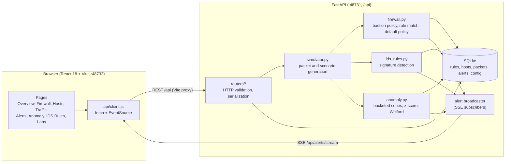
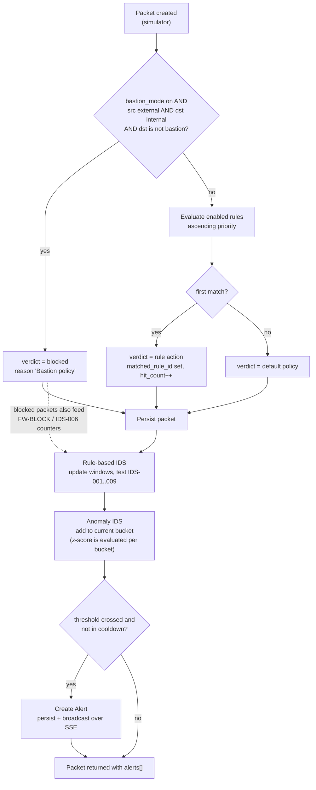
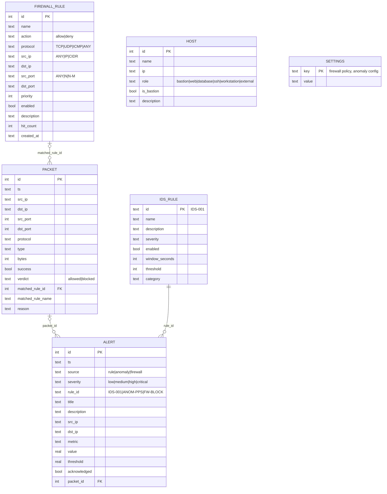
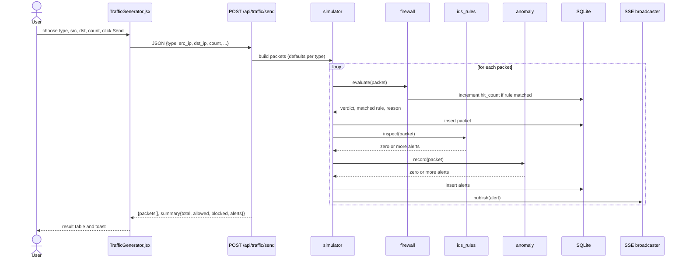
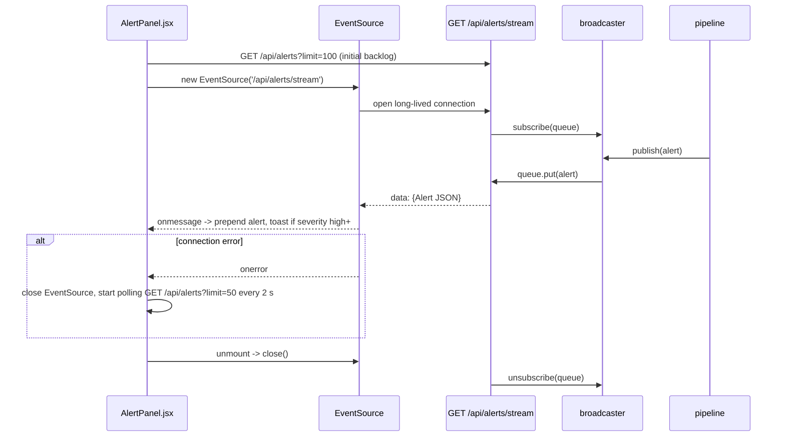

# Sentinel Architecture

This document describes how Sentinel is built. The binding interface definition is [API_CONTRACT.md](API_CONTRACT.md); where this file and the contract disagree, the contract wins.

## 1. Component overview

| Component | Responsibility |
|---|---|
| `routers/` | Thin HTTP layer: parse and validate input (Pydantic), call domain modules, shape responses. No detection logic. |
| `simulator.py` | Turns a request (`type`, `count`, scenario name) into concrete `Packet` objects with defaults per traffic type, then feeds each packet through the pipeline. |
| `firewall.py` | Pure decision logic: bastion policy, ordered rule matching (IP/CIDR, port range, protocol), default policy. Also the dry-run `test` path. |
| `ids_rules.py` | Sliding-window signature engine for IDS-001..009 with per-(rule, source) cooldowns. |
| `anomaly.py` | Time-bucketed metrics, trailing-baseline z-score, per-source Welford profile, configuration, baseline back-fill. |
| `db.py` / `models.py` | SQLite connection and schema; Pydantic models mirroring the contract. |
| `alert_bus.py` | Thread-safe in-process pub/sub. Each SSE client owns a bounded queue; a slow client drops events instead of blocking the pipeline. |
| `clock.py` | Injectable time source (`system_clock`, `ManualClock`) so engines and tests control time deterministically. |
| `frontend/src/api/client.js` | Single place that knows URLs; pages never call `fetch` directly. |

## 2. Packet-processing pipeline

Every simulated packet, whether from `/traffic/send` or a scenario, passes through the same ordered stages.

Stage semantics:

1. **Firewall.** The bastion check runs first and short-circuits. Otherwise enabled rules are tested by ascending `priority`; the first match decides. No match falls to `default_action`. A matched rule's `hit_count` is incremented. Blocked packets are still inspected by the IDS, because denied traffic is itself evidence (IDS-006 counts firewall denials).
2. **Rule-based IDS.** Each enabled signature keeps a sliding window keyed by the rule's grouping field (usually source IP). When the count reaches the threshold inside `window_seconds`, an alert fires and the (rule, source) pair is silenced for the window length.
3. **Anomaly IDS.** The packet is accumulated into the current time bucket (default 5 s). Completed buckets are scored: `z = (x - mean) / std` over the trailing baseline excluding the current bucket (minimum 10 buckets, std floored at an epsilon). `z > sigma` marks the bucket anomalous and raises an alert (`ANOM-PPS` and siblings). Per-source packets/sec uses a Welford running mean/variance and raises `ANOM-SRC`.
4. **Alerts.** Persisted, then pushed to every connected SSE client.

## 3. Data model

Notes: tables are created in `backend/app/db.py` (`hosts`, `firewall_rules`, `packets`, `alerts`, `settings`, `ids_rules`); timestamps are stored as epoch seconds and converted to ISO-8601 UTC strings at the API boundary (`clock.iso`). `ALERT.rule_id` is a string identifier, not a database foreign key, because it also carries non-`IDS_RULE` identifiers (`ANOM-*`, `FW-BLOCK`). `alerts.packet_id` links an alert to the packet that triggered it where one exists (anomaly alerts raised on a bucket may have none). Anomaly time series are held in memory, not in SQLite.

## 4. Sequence: sending traffic

## 5. Sequence: SSE alert streaming

The client de-duplicates by alert `id`, so the backlog fetch, stream events and polling results can overlap safely.

## 6. Events, investigation, settings and deployment

- **Unified SSE `/api/events`**: a single stream replaces per-page polling. Events are typed: `summary` (dashboard counters changed), `alert` (new alert) and `change` (configuration or data changed, so views should refetch). `GET /api/alerts/stream` remains for the alert-only feed.
- **`GET /api/investigate/{ip}`**: aggregates what Sentinel knows about one address (packets, verdicts, alerts) for the Investigate page.
- **`/api/settings`**: stores runtime settings, currently data retention.
- **Pagination**: list endpoints take `offset` and return the full count in `X-Total-Count`.
- **Traffic rate limiting**: the traffic endpoints reject excessive request rates to protect the in-process pipeline.
- **Frontend**: routes are code-split (lazy loaded), a command palette (Ctrl/Cmd+K) provides navigation, and a light/dark theme is persisted in the browser.
- **Launchers**: `start-all.*` pick the next free port when 48731 / 48732 are taken and pass them to uvicorn and Vite via `SENTINEL_API_PORT` / `SENTINEL_FE_PORT`.
- **Docker**: `docker-compose.yml` runs `backend` (uvicorn, SQLite on the `sentinel-data` volume via `SENTINEL_DB`) and `frontend` (nginx serving the Vite build, proxying `/api` with `proxy_buffering off`, HTTP/1.1 and a long `proxy_read_timeout` for SSE).

## 7. Design decisions and trade-offs

| Decision | Rationale | Trade-off |
|---|---|---|
| Simulated traffic, no real capture | Safe to demo anywhere, deterministic, no privileges or drivers | Cannot demonstrate payload inspection or real protocol behaviour |
| Same pipeline for every packet | One code path to test; scenarios are just packet generators | Scenario realism is limited to the attributes the pipeline reads |
| Stateless first-match firewall | Matches textbook packet filters; easy to visualise rule ordering | No connection tracking; return traffic is not modelled |
| Bastion check before rules | Makes the bastion concept enforceable regardless of rule mistakes | A permissive rule cannot override it while bastion mode is on |
| Blocked packets still reach the IDS | Detects scanning and storms that the firewall hides | Higher alert volume; mitigated by cooldowns |
| Cooldown equal to rule window | Prevents alert spam during sustained attacks | A long attack yields one alert per window, not a continuous signal |
| z-score on a trailing baseline excluding the current bucket | Simple, explainable on a slide; current spike does not inflate its own baseline | Assumes roughly normal behaviour; needs warm-up (`min_samples`) and a baseline endpoint for demos |
| std floored at epsilon | Avoids division by zero on perfectly flat series | A flat series makes tiny deviations look huge; the min-sample guard limits this |
| Welford per-source profile | O(1) memory per source, numerically stable | No forgetting; long-lived profiles adapt slowly |
| SQLite via stdlib `sqlite3` | Zero setup, single file, no ORM to learn | Single-writer; fine for a single-process simulator |
| SSE rather than WebSocket | One-way push is all that is needed; plain HTTP, built-in browser reconnect, proxy friendly | No client-to-server channel (not required); polling fallback needed for restrictive environments |
| Vite proxy for `/api` | Same-origin in dev, no CORS friction | CORS still configured for `http://localhost:48732` for direct access |
| Process-local detection state | Simplicity and speed | Must run one worker; state lost on restart |
| Contract-first development | Backend and frontend built in parallel against `API_CONTRACT.md` | Changes require updating the contract first |
